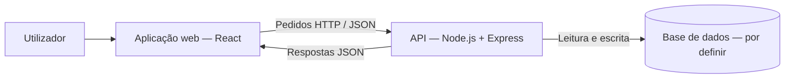

# Arquitetura do Software

## 1. Objetivo do documento

Este documento apresenta a arquitetura inicial do sistema de gestão de pedidos de funcionalidades e do roadmap de produtos (Feature Request & Product Roadmap Management System), desenvolvido no âmbito da unidade curricular de Engenharia de Software.

Descreve os componentes do sistema, as suas responsabilidades, a comunicação entre componentes e a justificação das tecnologias. A arquitetura será atualizada ao longo dos sprints, de acordo com a evolução dos requisitos.

## 2. Estado das decisões

| Decisão | Estado |
| --- | --- |
| React para o front-end | Definida |
| Node.js para o back-end | Definida |
| Express como framework de back-end | Proposta a validar pela equipa |
| Arquitetura cliente–servidor com back-end monolítico modular | Proposta a validar pela equipa |
| Comunicação através de API HTTP com mensagens JSON | Proposta a validar pela equipa |
| Um repositório para front-end e back-end | Proposta a validar pela equipa |
| Sistema de gestão de base de dados e biblioteca de acesso a dados | Por definir |
| Mecanismo de autenticação e permissões | Por definir |
| Ferramenta de IA de apoio à programação | Por definir |
| Alojamento e pipeline de integração e entrega contínuas | Por definir |

As propostas deste documento não representam decisões já aprovadas pela equipa. Node.js é o ambiente de execução do back-end; Express é a framework proposta para implementar a API.

## 3. Contexto e âmbito do sistema

O sistema permitirá acompanhar a evolução de um produto desde a submissão de um pedido de funcionalidade até ao seu planeamento e implementação.

O âmbito funcional previsto inclui:

- Submissão, categorização, pesquisa e acompanhamento de pedidos de funcionalidades.
- Priorização de pedidos, votação e estimativa de impacto e esforço.
- Gestão do product backlog e dos sprint backlogs.
- Visualização do roadmap, planeamento de releases e gestão de dependências.
- Gestão de user stories, critérios de aceitação e rastreabilidade.
- Colaboração através de comentários, notificações, menções e espaços de trabalho.
- Consulta de métricas de progresso e carga de trabalho.

Os intervenientes incluem clientes/utilizadores, gestores de produto ou Product Owners, programadores e gestores de projeto. Os seus perfis e permissões concretas serão definidos durante a análise de requisitos.

A arquitetura deve acomodar este âmbito, mas a estrutura inicial do repositório não pressupõe que todas as funcionalidades estejam já implementadas.

## 4. Estilo arquitetural proposto

Propõe-se uma arquitetura cliente–servidor composta por uma aplicação web em React, uma API em Node.js com Express e uma base de dados.

O back-end será inicialmente uma única aplicação, organizada por módulos funcionais e com separação interna de responsabilidades. Esta opção corresponde a um monólito modular, não a uma arquitetura de microserviços.

### 4.1. Justificação

Esta proposta procura:

- Separar a interface das regras de negócio e da persistência de dados.
- Permitir trabalho em paralelo no front-end e no back-end, através de contratos de API acordados.
- Manter a execução e a configuração inicial adequadas ao contexto académico.
- Evitar, nesta fase, a complexidade de distribuir funcionalidades por vários serviços.
- Facilitar a alteração e o teste das regras de negócio sem as concentrar nas rotas HTTP.

A modularidade organiza o código, mas não garante por si só escalabilidade. As necessidades de desempenho e de alojamento serão avaliadas quando existirem requisitos e condições de utilização mais concretos.

### 4.2. Visão geral



Este diagrama representa os componentes lógicos da aplicação. Não define ainda a sua distribuição por servidores nem implica a utilização de Docker.

## 5. Componentes e responsabilidades

### 5.1. Front-end — React

Responsabilidades propostas:

- Apresentar as interfaces e os estados da aplicação.
- Recolher dados introduzidos pelos utilizadores.
- Efetuar pedidos à API e apresentar os resultados.
- Tratar estados de carregamento, erro e ausência de resultados.
- Reutilizar componentes visuais, como filtros, formulários e cartões de funcionalidades.
- Efetuar validações de interface para melhorar a experiência de utilização.

As validações e as restrições apresentadas no front-end não substituem a validação e a autorização no servidor.

### 5.2. Back-end — Node.js com Express proposto

Responsabilidades propostas:

- Disponibilizar a API consumida pelo front-end.
- Validar os dados recebidos.
- Aplicar as regras de negócio.
- Verificar a identidade e as permissões dos utilizadores, quando esses mecanismos forem implementados.
- Coordenar o acesso à base de dados.
- Produzir respostas e erros consistentes.
- Gerir eventuais integrações externas, sem expor as respetivas credenciais no front-end.

### 5.3. Base de dados

A base de dados será responsável pela persistência da informação. A tecnologia será escolhida considerando as relações entre entidades, as necessidades de integridade e transações, a experiência da equipa e o ambiente de alojamento.

As entidades candidatas incluem utilizadores, espaços de trabalho, pedidos de funcionalidades, votos, comentários, user stories, sprints e releases. Esta lista é preliminar e não constitui ainda um modelo de dados final.

## 6. Justificação das tecnologias

### 6.1. React

React foi escolhido para o front-end pela organização da interface em componentes e pela possibilidade de reutilizar elementos entre diferentes páginas.

No contexto deste projeto, esta abordagem permite estruturar elementos como listas de pedidos, formulários, filtros, indicadores e vistas do roadmap, mantendo a apresentação separada da implementação das regras de negócio no servidor.

Limitações e cuidados a considerar:

- É necessário acordar a organização dos componentes e do estado da aplicação.
- As bibliotecas de navegação, visualização e gestão de estado serão escolhidas apenas quando necessárias.
- As permissões não podem depender apenas de esconder elementos na interface.

### 6.2. Node.js

Node.js foi escolhido para executar o back-end em JavaScript. A utilização da mesma linguagem no front-end e no back-end pretende reduzir a alternância entre tecnologias e facilitar a colaboração entre os membros da equipa.

O back-end irá receber pedidos da interface, aplicar regras e coordenar operações sobre os dados.

Limitações e cuidados a considerar:

- A partilha de linguagem não elimina a necessidade de definir contratos entre cliente e servidor.
- Operações computacionalmente intensivas não devem ser introduzidas no processamento dos pedidos sem avaliação do seu impacto.
- Dependências, configuração e tratamento de erros devem ser geridos de forma consistente.

### 6.3. Express — proposta

Propõe-se Express para complementar Node.js na construção da API. A escolha pretende fornecer uma base para definir rotas e middleware sem impor uma estrutura de aplicação demasiado extensa para a fase inicial.

Como esta flexibilidade não define automaticamente a arquitetura interna, a equipa deverá seguir a separação de responsabilidades descrita na secção seguinte.

A adoção de Express deve ser confirmada pela equipa antes de ser apresentada como decisão definitiva.

## 7. Organização interna do back-end

Propõe-se a organização por módulos funcionais, separando, dentro de cada módulo, as seguintes responsabilidades:

| Elemento | Responsabilidade |
| --- | --- |
| Routes | Associar métodos e caminhos HTTP aos handlers e middleware adequados. |
| Controllers | Interpretar o pedido, invocar os serviços e produzir a resposta HTTP. |
| Services | Implementar regras de negócio e coordenar operações. |
| Repositories | Isolar o acesso e a persistência de dados. |
| Middleware partilhado | Tratar preocupações transversais, como autenticação, validação e erros, quando aplicável. |

Fluxo previsto:

```text
Pedido HTTP → Middleware / Route → Controller → Service → Repository → Base de dados
```

Os módulos candidatos incluem `features`, `votes`, `comments`, `backlog`, `roadmap`, `releases` e `users`. Não é necessário criar todos os módulos antes de existirem funcionalidades a implementar.

## 8. Comunicação e proposta inicial da API

Propõe-se que o front-end comunique com o back-end através de uma API HTTP, utilizando JSON para os dados de negócio. O front-end não acederá diretamente à base de dados.

A tabela seguinte é apenas um esboço inicial. Os endpoints, os seus dados de entrada, as respostas e as permissões serão refinados com base nas user stories e nos critérios de aceitação.

| Método | Endpoint proposto | Finalidade |
| --- | --- | --- |
| GET | `/api/health` | Verificar se a API está em execução. |
| GET | `/api/features` | Listar e filtrar pedidos de funcionalidades. |
| POST | `/api/features` | Submeter um pedido de funcionalidade. |
| GET | `/api/features/:id` | Consultar o detalhe de um pedido. |
| PATCH | `/api/features/:id` | Atualizar os campos permitidos de um pedido. |
| PATCH | `/api/features/:id/status` | Alterar o estado de um pedido. |
| POST | `/api/features/:id/votes` | Registar um voto do utilizador. |
| POST | `/api/features/:id/comments` | Adicionar um comentário. |
| GET | `/api/roadmap` | Consultar os dados do roadmap. |
| GET | `/api/releases` | Consultar as releases planeadas. |

Questões a resolver na especificação detalhada:

- Como identificar o produto ou espaço de trabalho em cada operação.
- Que perfis podem consultar, criar ou alterar cada recurso.
- Como impedir votos duplicados, se essa for a regra acordada.
- Que transições de estado são permitidas.
- Como representar erros, paginação, ordenação e filtros.

## 9. Estrutura inicial proposta do repositório

Propõe-se manter as duas aplicações no mesmo repositório, preservando a sua separação em diretórios próprios.

```text
projeto/
├── frontend/
│   ├── src/
│   │   ├── components/
│   │   ├── pages/
│   │   └── services/
│   ├── .env.example
│   └── package.json
├── backend/
│   ├── src/
│   │   ├── config/
│   │   ├── middleware/
│   │   ├── modules/
│   │   │   └── features/
│   │   │       ├── feature.routes.js
│   │   │       ├── feature.controller.js
│   │   │       ├── feature.service.js
│   │   │       └── feature.repository.js
│   │   ├── app.js
│   │   └── server.js
│   ├── tests/
│   ├── .env.example
│   └── package.json
├── docs/
│   ├── architecture.md
│   └── ai-tool.md
├── .gitignore
└── README.md
```

Esta árvore é uma proposta de organização, não evidência de que os ficheiros já existem. As pastas devem ser introduzidas à medida que forem necessárias. A escolha de JavaScript ou TypeScript para o código-fonte ainda deverá ser confirmada; os nomes acima exemplificam uma estrutura em JavaScript.

O `README.md` deverá explicar os pré-requisitos, a instalação, a configuração e os comandos para executar cada aplicação.

## 10. Segurança e configuração

Princípios propostos para orientar a implementação:

- Validar dados recebidos no back-end.
- Verificar permissões no servidor, incluindo o acesso ao recurso concreto solicitado.
- Não colocar passwords, tokens ou outras credenciais no repositório.
- Manter valores locais de configuração em ficheiros excluídos do Git e disponibilizar exemplos sem segredos.
- Não tratar variáveis incluídas no front-end como armazenamento de segredos.
- Evitar expor detalhes internos nos erros devolvidos ao utilizador.
- Configurar CORS de acordo com as origens necessárias, caso cliente e API utilizem origens diferentes; CORS não substitui autenticação nem autorização.
- Prever HTTPS no ambiente de disponibilização da aplicação.

Os mecanismos concretos de autenticação, gestão de sessões e armazenamento de passwords serão documentados quando forem escolhidos.

## 11. Estratégia inicial de testes

Propõe-se introduzir progressivamente:

- Testes unitários das regras de negócio nos services.
- Testes de integração dos endpoints e da interação com os dados.
- Testes de componentes ou fluxos do front-end, conforme a evolução da interface.

Na estrutura inicial, um endpoint de saúde e uma chamada de teste a partir do React podem demonstrar a comunicação entre aplicações. Esse teste não demonstra, por si só, o funcionamento de autenticação ou persistência.

As bibliotecas de testes e os critérios de execução em integração contínua estão por definir.

## 12. IA de apoio ao desenvolvimento

A ferramenta de IA de apoio à programação será selecionada pela equipa e documentada em `docs/ai-tool.md`.

Utilizações previstas:

- Apoio à criação de código base.
- Sugestão de testes.
- Explicação de erros e alternativas de implementação.
- Apoio à refatorização e documentação.

O código sugerido deverá ser compreendido, revisto e validado pelos membros da equipa. Não deverão ser partilhadas credenciais nem dados sensíveis com a ferramenta.

Esta ferramenta faz parte do processo de desenvolvimento: a sua adoção não significa necessariamente integrar um serviço de IA na aplicação. É também distinta da utilização de Character.ai para levantamento de requisitos.

As funcionalidades de IA previstas no produto, como sugestões de priorização, exigirão decisões técnicas próprias quando forem especificadas.

## 13. Critérios propostos para concluir a preparação inicial

- [ ] Arquitetura e propostas revistas pela equipa.
- [ ] Justificação de React e Node.js registada.
- [ ] Framework de back-end confirmada.
- [ ] Repositório criado e acessível à equipa.
- [ ] Front-end inicializado e executável localmente.
- [ ] Back-end inicializado e executável localmente.
- [ ] Instruções de execução registadas no README.
- [ ] Configuração de exemplo e exclusões do Git preparadas.
- [ ] Ferramenta de IA escolhida e preparação documentada.
- [ ] Documento e repositório associados à tarefa no Jira.

Como demonstração adicional, recomenda-se validar a comunicação entre o front-end e o endpoint de saúde da API.

Esta checklist traduz a tarefa de preparação em resultados verificáveis; não substitui o sprint backlog acordado pela equipa nem estabelece novos requisitos de avaliação.

## 14. Próximas decisões

1. Validar esta proposta com a equipa.
2. Escolher a base de dados e a estratégia de acesso aos dados.
3. Consolidar os perfis de utilizador e as permissões.
4. Refinar as entidades e os contratos de API a partir dos requisitos.
5. Escolher e configurar as ferramentas de testes e de IA.
6. Documentar o ambiente de alojamento e a estratégia de integração e entrega contínuas.
